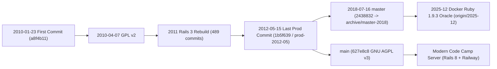
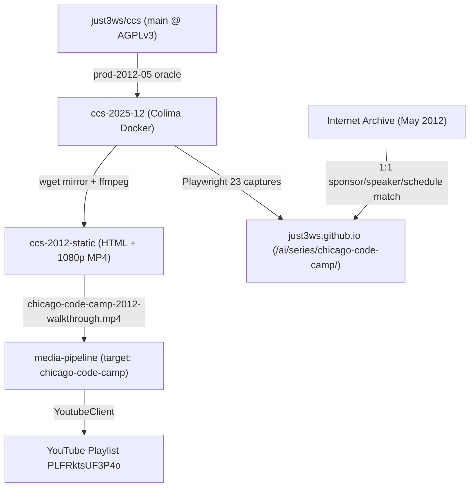

# Code Camp Server (`ccs`): Archival Retrospective, Surfaces & Roadmap

## 1. Where "Here" Really Is

This repository (`just3ws/ccs`) is the Rails application that powered **Chicago Code Camp** (`chicagocodecamp.com`) across May 2010, May 2011, and May 2012.

| Surface | Location / Identifier | Current State |
| :--- | :--- | :--- |
| **Production Anchor Tag** | `prod-2012-05` (`1b5f639`, `2012-05-15`) | Tagged & pushed to `origin` |
| **Active Default Branch** | `main` (`627e8c8+`) | Branched from `1b5f639`, relicensed to **GNU AGPL v3** |
| **Archived Branch** | `archive/master-2018` (`2438832`) | Preserves 2018 tweaks; `origin/master` deleted |
| **Historical Branches** | `origin/2012-05`, `origin/2.0`, `origin/2025-12` | Preserved untouched on `origin` |
| **2012 Colima Oracle** | `../ccs-2025-12` (`origin/2025-12`) | Dockerized Ruby `1.9.3-p551` + Postgres 9.6 + Memcached 1.6 (spun down cleanly) |
| **Static HTML Mirror** | `../ccs-2012-static` | Offline `wget` mirror + `chicago-code-camp-2012-walkthrough.mp4` (1080p, 49s) |
| **`just3ws.localhost` Series** | `/ai/series/chicago-code-camp/` | Hub + Episodes 01–03 + 23 screenshots in `assets/images/chicago-code-camp-2012/` |
| **`media-pipeline` & YouTube** | Playlist `PLFRktsUF3P4o` (`chicago-code-camp`) | Target synced; walkthrough MP4 staged in `pending/` |

---

## 2. Git Lineage & Archival Flow

---

## 3. Cross-Repo Surface Map

---

## 4. Tooling & Documentation Inventory

- **CLI helper:** [`script/ccs-archive`](../script/ccs-archive) (`--help`, `status`, `boot`, `down`, `snapshot`)
- **Manpage:** [`doc/man/ccs-archive.1`](man/ccs-archive.1) (`man ./doc/man/ccs-archive.1`)
- **Agent skill:** [`.agents/skills/ccs-archival-steward/SKILL.md`](../.agents/skills/ccs-archival-steward/SKILL.md)
- **Specialist agent:** [`.agents/agents/ccs-historian.md`](../.agents/agents/ccs-historian.md)

---

## 5. Recommendations: Where to Go Next

1. **Publish the `just3ws.github.io` & `media-pipeline` changes:**
   - Review and commit the new `ai/series/chicago-code-camp/`, `assets/images/chicago-code-camp-2012/`, and `_data/media_intake_targets.yml` changes in `just3ws.github.io`, and `config/youtube_playlist_descriptions.yml` in `media-pipeline`.
   - Complete the mandatory editorial review in `media-pipeline` once `chicago-code-camp-2012-walkthrough.mp4` finishes enrichment.
2. **Level up the video series (optional):**
   - Add lower-third chapter titles and voiceover to `chicago-code-camp-2012-walkthrough.mp4` using `ffmpeg-full`, and record live ActiveAdmin / Rails console segments for Episodes 02 and 03.
3. **Modernize `main` into Code Camp Server (Rails 8 + Railway):**
   - Keep `../ccs-2025-12` as the runnable 2012 behavioral oracle.
   - Generate a fresh Rails 8 skeleton on current Ruby inside `main` (preserving 100% of git history), port the 19-table schema and 17 models, replace `activeadmin`/`formtastic`/`cancan`/`devise ~1`/`heroku_san`, and extract Chicago Code Camp-specific config into event settings.
